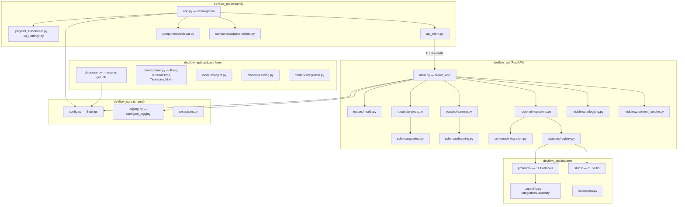

# DevFlow AI — Phase 0: Foundation & Architecture Design

**Version:** 1.1.1  
**Status:** Draft — Awaiting Approval  
**Scope:** Phase 0 — Foundation & Architecture  
**Last Updated:** 2026-11-14  
**Supersedes:** v1.1.0

---

## 1. Architecture Overview

DevFlow AI is structured as a **modular monolith** deployed as two cooperating processes: a Streamlit multipage UI and a FastAPI REST backend. Both processes run locally, containerised via Docker Compose (Task 20). The host sees both services only on `127.0.0.1`; Docker bridge networking allows the UI container to reach the API container by service name (`devflow-api`) on the internal network, where both processes bind to `0.0.0.0`. The SQLite database is mounted exclusively on the API container via a named volume, never exposed to the UI container.

The core architectural principle is **dependency inversion at every boundary**: the Streamlit UI depends only on a typed `APIClient` abstraction; the FastAPI routers depend only on domain service interfaces; domain services depend only on repository abstractions; and all external AI integrations are accessed exclusively through typed `Protocol` contracts with declared `IntegrationCapability` metadata. No layer holds a direct reference to a concrete implementation from another layer, except at the composition root (application startup).

A key correction from v1.0.0: **not all integrations have programmatic APIs**. Kiro, NotebookLM (personal), Antigravity, and Google Stitch operate as manual or unclassified handoffs. Their protocols are intentionally narrow. A key correction from v1.1.0: **Codex is a `cli_handoff`, not `automated_api`**. Codex CLI is the preferred local integration; it does not require an OpenAI API key, though CLI usage is not guaranteed to be free or unlimited. The `ExecutionMode` enum makes all classifications explicit and prevents Phase 0 stubs from implying false connectivity.

Technology choices are locked for Phase 0:

| Concern | Technology |
|---|---|
| UI Framework | Streamlit 1.x (multipage, `st.Page`/`st.navigation`) |
| API Framework | FastAPI 0.x + Uvicorn |
| Data Validation | Pydantic v2 |
| ORM | SQLAlchemy 2 (async + aiosqlite) |
| Database | SQLite |
| Migrations | Alembic |
| Configuration | pydantic-settings + python-dotenv |
| Logging | structlog (structured JSON / console) |
| HTTP Client | httpx (async) |
| Testing | Pytest + pytest-asyncio + Streamlit AppTest |
| Linting | Ruff |
| Type Checking | MyPy (strict mode) |
| Containerisation | Docker Compose v2 (Task 20) |
| CI | GitHub Actions (ubuntu-latest) |
| Security | Bandit, pip-audit, detect-secrets, trufflehog |
| Developer scripts | GNU Make (Linux/macOS) + PowerShell `scripts/dev.ps1` (Windows) |

---

## 2. System Diagram

```
  Developer Machine
  ┌────────────────────────────────────────────────────────────────────┐
  │  Host network interface: 127.0.0.1 only                            │
  │                                                                      │
  │  ┌──────────────────────┐       ┌───────────────────────────────┐  │
  │  │  Browser             │       │  curl / httpie / Postman      │  │
  │  │  http://localhost:8501│       │  http://localhost:8000        │  │
  │  └──────────┬───────────┘       └────────────────┬──────────────┘  │
  │             │ 127.0.0.1:8501                       │ 127.0.0.1:8000  │
  │  ═══════════╪═════════════════════════════════════╪════════════════ │
  │             │   Docker bridge network (internal)   │                 │
  │  ┌──────────▼───────────────┐   ┌─────────────────▼─────────────┐  │
  │  │  devflow-ui              │   │  devflow-api                  │  │
  │  │  Streamlit :8501         │   │  FastAPI/Uvicorn :8000        │  │
  │  │  (binds 0.0.0.0:8501)   │   │  (binds 0.0.0.0:8000)        │  │
  │  │                          │   │                                │  │
  │  │  ┌────────────────────┐  │   │  ┌────────────────────────┐  │  │
  │  │  │  10 pages          │  │   │  │  Routers /api/v1/      │  │  │
  │  │  │  APIClient(httpx)  │──┼───┼─▶│  /health               │  │  │
  │  │  └────────────────────┘  │   │  │  /projects             │  │  │
  │  │                          │   │  │  /learning             │  │  │
  │  └──────────────────────────┘   │  │  /integrations         │  │  │
  │                                  │  └──────────┬─────────────┘  │  │
  │                                  │             │                  │  │
  │                                  │  ┌──────────▼─────────────┐  │  │
  │                                  │  │  Adapter Registry      │  │  │
  │                                  │  │  (11 stubs, Phase 0)   │  │  │
  │                                  │  └────────────────────────┘  │  │
  │                                  │                                │  │
  │                                  │  ┌────────────────────────┐  │  │
  │                                  │  │  SQLAlchemy 2 (async)  │  │  │
  │                                  │  └──────────┬─────────────┘  │  │
  │                                  │             │                  │  │
  │                                  │  ┌──────────▼─────────────┐  │  │
  │                                  │  │  devflow-data volume   │  │  │
  │                                  │  │  /data/devflow.db      │  │  │
  │                                  │  └────────────────────────┘  │  │
  │                                  └───────────────────────────────┘  │
  └────────────────────────────────────────────────────────────────────┘
```

---

## 3. Module Boundary Diagram



---

## 4. Directory and Package Layout

Every directory containing Python code has an `__init__.py`. The `src/` layout requires an editable install (`pip install -e .`) for imports to resolve without path manipulation.

```
devflow-ai/
│
├── .editorconfig
├── .env                              ← NOT in VCS (gitignored)
├── .env.example                      ← committed; placeholder values only
├── .gitignore
├── .pre-commit-config.yaml
├── .secrets.baseline                 ← detect-secrets baseline
├── .vscode/
│   └── settings.json
├── Makefile                          ← Linux/macOS targets
├── scripts/
│   └── dev.ps1                       ← Windows PowerShell equivalent
├── README.md                         ← extended (stub preserved)
├── pyproject.toml
├── alembic.ini
│
├── alembic/
│   ├── env.py
│   ├── script.py.mako
│   └── versions/
│       └── 001_create_initial_tables.py
│
├── docs/
│   ├── adr/
│   │   ├── ADR-0001-modular-monolith.md
│   │   ├── ADR-0002-sqlite-for-local-first.md
│   │   ├── ADR-0003-alembic-migrations.md
│   │   └── ADR-0004-streamlit-ui.md
│   └── openapi.json                  ← generated by `make docs` or dev.ps1
│
├── requirements/
│   ├── base.txt                      ← pinned runtime deps
│   ├── dev.txt                       ← includes -r base.txt
│   └── test.txt                      ← includes -r dev.txt
│
├── src/
│   ├── devflow_core/
│   │   ├── __init__.py
│   │   ├── config.py                 ← pydantic-settings Settings
│   │   ├── logging.py                ← structlog setup
│   │   └── exceptions.py             ← DevFlowError, ConfigurationError
│   │
│   ├── devflow_api/
│   │   ├── __init__.py
│   │   ├── main.py                   ← create_app() factory
│   │   ├── database.py               ← engine, AsyncSessionLocal, get_db
│   │   │
│   │   ├── models/
│   │   │   ├── __init__.py
│   │   │   ├── base.py               ← Base, UTCDateTime TypeDecorator, TimestampMixin
│   │   │   ├── project.py
│   │   │   ├── learning.py
│   │   │   └── integration.py
│   │   │
│   │   ├── schemas/
│   │   │   ├── __init__.py
│   │   │   ├── common.py             ← ErrorResponse, HealthResponse
│   │   │   ├── project.py
│   │   │   ├── learning.py
│   │   │   └── integration.py        ← includes IntegrationSummary, capability fields
│   │   │
│   │   ├── repositories/
│   │   │   ├── __init__.py
│   │   │   ├── base.py
│   │   │   ├── project.py
│   │   │   ├── learning.py
│   │   │   └── integration.py
│   │   │
│   │   ├── services/
│   │   │   ├── __init__.py
│   │   │   ├── project.py
│   │   │   ├── learning.py
│   │   │   └── integration.py
│   │   │
│   │   ├── routers/
│   │   │   ├── __init__.py
│   │   │   ├── health.py
│   │   │   ├── projects.py
│   │   │   ├── learning.py
│   │   │   └── integrations.py
│   │   │
│   │   ├── middleware/
│   │   │   ├── __init__.py
│   │   │   ├── logging.py
│   │   │   └── error_handler.py
│   │   │
│   │   └── adapters/
│   │       ├── __init__.py
│   │       ├── capability.py         ← ExecutionMode enum, IntegrationCapability
│   │       ├── registry.py
│   │       ├── exceptions.py
│   │       ├── protocols/
│   │       │   ├── __init__.py
│   │       │   ├── base.py
│   │       │   ├── chatgpt.py        ← automated_api
│   │       │   ├── codex.py          ← cli_handoff (request + approved execution)
│   │       │   ├── kiro.py           ← manual_handoff (health_check + get_instructions)
│   │       │   ├── claude.py         ← automated_api
│   │       │   ├── antigravity.py    ← unknown (health_check only)
│   │       │   ├── stitch.py         ← unknown (health_check only)
│   │       │   ├── figma.py          ← automated_api
│   │       │   ├── notebooklm.py     ← manual_handoff (health_check + get_instructions)
│   │       │   ├── github.py         ← automated_api
│   │       │   ├── ollama.py         ← automated_api (local, no key)
│   │       │   └── mcp.py            ← automated_api (local JSON-RPC)
│   │       └── stubs/
│   │           ├── __init__.py
│   │           ├── chatgpt.py
│   │           ├── codex.py
│   │           ├── kiro.py
│   │           ├── claude.py
│   │           ├── antigravity.py
│   │           ├── stitch.py
│   │           ├── figma.py
│   │           ├── notebooklm.py
│   │           ├── github.py
│   │           ├── ollama.py
│   │           └── mcp.py
│   │
│   └── devflow_ui/
│       ├── __init__.py
│       ├── app.py                    ← st.set_page_config + st.navigation
│       ├── api_client.py
│       ├── components/
│       │   ├── __init__.py
│       │   ├── sidebar.py
│       │   └── placeholders.py
│       └── pages/
│           ├── 1_Dashboard.py
│           ├── 2_Projects.py
│           ├── 3_Learning.py
│           ├── 4_Specifications.py
│           ├── 5_Design.py
│           ├── 6_Coding.py
│           ├── 7_Testing.py
│           ├── 8_Documentation.py
│           ├── 9_Integrations.py
│           └── 10_Settings.py
│
├── tests/
│   ├── conftest.py
│   ├── unit/
│   │   ├── __init__.py
│   │   ├── test_config.py
│   │   ├── test_logging.py
│   │   ├── test_models.py
│   │   ├── test_health.py
│   │   ├── test_projects_router.py
│   │   ├── test_learning_router.py
│   │   ├── test_integrations_router.py
│   │   └── test_adapters.py
│   ├── smoke/
│   │   ├── __init__.py
│   │   └── test_ui_pages.py
│   └── integration/
│       ├── __init__.py
│       └── test_database.py
│
├── .github/
│   ├── dependabot.yml
│   └── workflows/
│       ├── ci.yml
│       └── security.yml
│
└── docker-compose.yml
```

---

## 5. Database Schema Strategy

### 5.1 UTCDateTime TypeDecorator

`DateTime(timezone=True)` instructs SQLAlchemy to store timezone information in the DDL, but SQLite ignores timezone metadata and returns plain strings. Reading back through SQLAlchemy yields a `datetime` without `tzinfo` unless a TypeDecorator converts the value explicitly. The `UTCDateTime` TypeDecorator defined here is the single authoritative fix for this problem; it MUST be used on all timestamp columns.

```python
# src/devflow_api/models/base.py
from __future__ import annotations
from datetime import datetime, timezone, UTC
from typing import Any
from sqlalchemy import DateTime, String
from sqlalchemy.engine import Dialect
from sqlalchemy.orm import DeclarativeBase, MappedColumn, mapped_column
from sqlalchemy.types import TypeDecorator

class UTCDateTime(TypeDecorator[datetime]):
    """
    A TypeDecorator that stores datetimes as UTC strings in SQLite and
    restores them as timezone-aware UTC datetime objects on read.

    Policy for naive inputs: raise ValueError — naive datetimes are
    ambiguous and must not be silently accepted.
    """
    impl = DateTime
    cache_ok = True

    def process_bind_param(
        self, value: datetime | None, dialect: Dialect
    ) -> datetime | None:
        if value is None:
            return None
        if value.tzinfo is None:
            raise ValueError(
                f"Naive datetime not accepted by UTCDateTime: {value!r}. "
                "Use datetime.now(UTC) or attach a timezone before persisting."
            )
        # Convert to UTC; this handles non-UTC timezone-aware inputs correctly
        return value.astimezone(UTC)

    def process_result_value(
        self, value: Any, dialect: Dialect
    ) -> datetime | None:
        if value is None:
            return None
        if isinstance(value, datetime):
            if value.tzinfo is None:
                # SQLite returns naive datetimes; attach UTC explicitly
                return value.replace(tzinfo=UTC)
            return value.astimezone(UTC)
        # Fallback for string representations from SQLite
        dt = datetime.fromisoformat(str(value))
        if dt.tzinfo is None:
            return dt.replace(tzinfo=UTC)
        return dt.astimezone(UTC)
```

**Why not `DateTime(timezone=True)`?** SQLite stores datetimes as TEXT (ISO 8601). The `timezone=True` flag is a no-op at the SQLite level — the driver does not preserve or inject timezone data. `UTCDateTime` owns the Python-side conversion completely, independent of the backend.

**Naive datetime rejection policy:** Naive datetimes raise `ValueError` at bind time. This is intentional. Silently coercing a naive value to UTC would be incorrect if the value was actually in a local timezone. All callers MUST pass timezone-aware UTC values (use `datetime.now(UTC)`, never `datetime.utcnow()`).

**`datetime.utcnow()` prohibition:** `datetime.utcnow()` returns a naive datetime and is deprecated in Python 3.12. It MUST NOT appear anywhere in the codebase. Use `datetime.now(UTC)` exclusively.

### 5.2 SQLAlchemy 2 Declarative Base and TimestampMixin

All models inherit from a single `Base` declared in `src/devflow_api/models/base.py`. The `TimestampMixin` uses `UTCDateTime` on all timestamp columns.

```python
# src/devflow_api/models/base.py (continued)
class Base(DeclarativeBase):
    pass

class TimestampMixin:
    """Timezone-aware UTC timestamps on every model using UTCDateTime."""
    created_at: MappedColumn[datetime] = mapped_column(
        UTCDateTime,
        default=lambda: datetime.now(UTC),
        nullable=False,
    )
    updated_at: MappedColumn[datetime] = mapped_column(
        UTCDateTime,
        default=lambda: datetime.now(UTC),
        onupdate=lambda: datetime.now(UTC),
        nullable=False,
    )
```

**Why lambdas instead of `datetime.now(UTC)` as a direct default?** Passing a callable avoids the "mutable default evaluated once at class definition" problem that affects SQLAlchemy's Python-side defaults.

**Alembic DDL compatibility:** Alembic autogenerate sees `UTCDateTime.impl = DateTime` and emits `DATETIME` DDL for SQLite — which is correct. No special handling in `env.py` is required.

### 5.3 Phase 0 Initial Schema

Three domain model groups anchor the architecture. All are intentionally minimal — columns are expanded in later phases.

**projects** (`src/devflow_api/models/project.py`)
```
id           INTEGER   PK  AUTOINCREMENT
name         TEXT      NOT NULL
description  TEXT
status       TEXT      NOT NULL  DEFAULT 'active'
             CHECK (status IN ('active', 'archived', 'completed'))
created_at   DATETIME  NOT NULL  (UTCDateTime — timezone-aware UTC)
updated_at   DATETIME  NOT NULL  (UTCDateTime — timezone-aware UTC)
```

**learning_items** (`src/devflow_api/models/learning.py`)
```
id           INTEGER   PK  AUTOINCREMENT
title        TEXT      NOT NULL
source_url   TEXT
status       TEXT      NOT NULL  DEFAULT 'pending'
             CHECK (status IN ('pending', 'in_progress', 'done'))
created_at   DATETIME  NOT NULL  (UTCDateTime)
updated_at   DATETIME  NOT NULL  (UTCDateTime)
```

**integration_configs** (`src/devflow_api/models/integration.py`)
```
id               INTEGER   PK  AUTOINCREMENT
integration_key  TEXT      NOT NULL  UNIQUE   -- slug matching adapter name
is_enabled       BOOLEAN   NOT NULL  DEFAULT 0
execution_mode   TEXT      NOT NULL           -- mirrors IntegrationCapability.execution_mode
config_json      TEXT                         -- JSON blob, per-adapter settings
created_at       DATETIME  NOT NULL  (UTCDateTime)
updated_at       DATETIME  NOT NULL  (UTCDateTime)
```

### 5.4 Async Session Lifecycle

The async engine and session factory are defined in `src/devflow_api/database.py`. Two important correctness requirements from v1.0.0 review:

1. **`get_db` must use a `finally` block** to ensure the session is always closed, even if the route handler raises.
2. **In-memory test databases require `StaticPool`** to prevent SQLite from treating each async context as a separate connection (which causes "Cannot operate on a closed database" errors).

```python
# Production engine (src/devflow_api/database.py)
engine = create_async_engine(
    settings.DATABASE_URL,
    echo=(settings.ENVIRONMENT == "development"),
)

# Test engine fixture (tests/conftest.py) — uses StaticPool
from sqlalchemy.pool import StaticPool
test_engine = create_async_engine(
    "sqlite+aiosqlite:///:memory:",
    connect_args={"check_same_thread": False},
    poolclass=StaticPool,
)
```

The `get_db` dependency:

```python
async def get_db() -> AsyncGenerator[AsyncSession, None]:
    async with AsyncSessionLocal() as session:
        try:
            yield session
        finally:
            await session.close()
```

### 5.5 Repository Pattern

A generic typed base in `src/devflow_api/repositories/base.py`:

```python
from typing import Generic, TypeVar, Type
from sqlalchemy.ext.asyncio import AsyncSession
from devflow_api.models.base import Base

ModelT = TypeVar("ModelT", bound=Base)

class BaseRepository(Generic[ModelT]):
    def __init__(self, model: Type[ModelT], session: AsyncSession) -> None: ...
    async def get(self, id: int) -> ModelT | None: ...
    async def list(self, offset: int = 0, limit: int = 50) -> list[ModelT]: ...
    async def create(self, obj_in: dict[str, object]) -> ModelT: ...
    async def update(self, id: int, obj_in: dict[str, object]) -> ModelT | None: ...
    async def delete(self, id: int) -> bool: ...
```

---

## 6. Alembic Migration Strategy

1. `alembic/env.py` imports `Settings` from `devflow_core.config` to read `DATABASE_URL` at runtime.
2. `alembic.ini` leaves `sqlalchemy.url` empty; `env.py` overrides it with the synchronous dialect URL (stripping `+aiosqlite` — Alembic uses a synchronous engine for migrations).
3. The initial migration (`001_create_initial_tables`) is authored manually so the reviewer can validate the schema before it runs.
4. Subsequent migrations use `alembic revision --autogenerate` as a starting point, then are edited and reviewed before commit.
5. Every migration MUST have a non-trivial `downgrade()`. CI runs the full round-trip: `upgrade head → downgrade -1 → upgrade head`.
6. WAL journal mode is enabled in `env.py` via a `PRAGMA journal_mode=WAL` executed on each connection.
7. **Tests MUST NOT run Alembic against the developer's `devflow.db`**. The integration test for migrations uses a `tmp_path`-scoped SQLite file isolated per test run (Task 19).
8. **Alembic DDL and `UTCDateTime`:** Alembic sees `UTCDateTime.impl = DateTime` and emits standard `DATETIME` DDL for SQLite. No `server_default=func.now()` is used for timestamp columns; Python-side defaults via `UTCDateTime.process_bind_param` are authoritative.

```python
# alembic/env.py — synchronous URL derivation
from devflow_core.config import get_settings
settings = get_settings()
# Strip async driver for Alembic's synchronous engine
sync_url = settings.DATABASE_URL.replace("+aiosqlite", "")
config.set_main_option("sqlalchemy.url", sync_url)
```

---

## 7. Integration Adapter Interface Contracts

### 7.1 Capability Metadata

A new module `src/devflow_api/adapters/capability.py` defines the execution mode classification that was missing in v1.0.0:

```python
from enum import StrEnum
from pydantic import BaseModel

class ExecutionMode(StrEnum):
    AUTOMATED_API  = "automated_api"   # programmatic REST/GraphQL API exists
    CLI_HANDOFF    = "cli_handoff"     # invoked via subprocess CLI
    MANUAL_HANDOFF = "manual_handoff"  # user-driven; no programmatic control
    UNKNOWN        = "unknown"         # API not yet publicly available

class IntegrationCapability(BaseModel):
    name: str
    execution_mode: ExecutionMode
    supported_actions: list[str]
    auth_required: bool
    auth_type: str | None          # "api_key" | "oauth" | "token" | "cli_auth" | None
    available_in_phase_0: bool     # always False for Phase 0
    notes: str = ""
```

### 7.2 Base Protocol

```python
# src/devflow_api/adapters/protocols/base.py
from typing import Protocol, runtime_checkable
from devflow_api.adapters.capability import IntegrationCapability

@runtime_checkable
class BaseAdapterProtocol(Protocol):
    @property
    def name(self) -> str: ...

    @property
    def capability(self) -> IntegrationCapability: ...

    async def health_check(self) -> dict[str, str]:
        """
        Returns {"status": "ok"|"stub"|"error",
                 "integration": self.name,
                 "execution_mode": self.capability.execution_mode}.
        MUST NOT raise; absorbs all exceptions and returns status=error.
        """
        ...
```

### 7.3 Per-Integration Protocol Scoping

Protocols are scoped by execution mode. The table below reflects the v1.1.1 correction: Codex is `cli_handoff`.

| Integration | Mode | Protocol Methods Beyond Base |
|---|---|---|
| ChatGPT | `automated_api` | `complete(prompt, model) → ChatGPTResponse` |
| **Codex** | **`cli_handoff`** | **`request_code_generation(description, language, workspace_path) → CodexCLIRequest`; `execute_approved_request(request: CodexCLIRequest) → CodexCLIResult`** |
| Kiro | `manual_handoff` | `get_instructions(task) → str` only — no `run_spec` |
| Claude | `automated_api` | `complete(prompt, model) → ClaudeResponse` |
| Antigravity | `unknown` | _(none beyond health_check)_ |
| Google Stitch | `unknown` | _(none beyond health_check)_ |
| Figma | `automated_api` | `get_file(file_key) → FigmaResponse` |
| NotebookLM | `manual_handoff` | `get_instructions(notebook_context) → str` only — no `query` |
| GitHub | `automated_api` | `create_issue(repo, title, body) → GitHubIssueResponse` |
| Ollama | `automated_api` | `generate(model, prompt) → OllamaResponse` |
| MCP Servers | `automated_api` | `call_tool(server, tool, args) → MCPResponse` |

**Rationale for Codex as `cli_handoff` (v1.1.1 correction):** DevFlow AI is local-first and free-tools-first. Codex CLI does not require an OpenAI API key. The API-based path (which requires a paid key) is demoted to an optional future adapter. The `cli_handoff` protocol models the two-phase interaction: (1) build a `CodexCLIRequest` for user review, (2) execute the approved request. This design enforces explicit approval and workspace restrictions even before real CLI execution is implemented. No real Codex subprocess execution occurs in Phase 0 — the stub returns typed placeholder results.

**CLI authentication and plan note:** Codex CLI may require authentication via `codex login` and may have usage limits depending on the user's OpenAI plan. This is documented in `IntegrationCapability.notes` for the Codex adapter. Free or unlimited access is not assumed.

**Rationale for Kiro as `manual_handoff`:** Kiro is an AI-assisted IDE without a public REST API. Workflow with Kiro is: a developer opens the spec in Kiro's interface and manually triggers its agent. The `get_instructions` method returns a formatted prompt/checklist the user can paste into Kiro.

**Rationale for Antigravity and Google Stitch as `unknown`:** Neither has a documented public API at the time of this spec. The stub exposes only `health_check` which always returns `status=stub`. Protocol methods will be defined when API documentation becomes available.

**Rationale for NotebookLM as `manual_handoff`:** Google NotebookLM (personal tier) has no public programmatic API. The workflow is: user uploads sources to NotebookLM and queries manually. `get_instructions` returns a checklist of what to upload and what to ask.

### 7.4 Codex CLI Request and Result Types

```python
# src/devflow_api/adapters/protocols/codex.py
from dataclasses import dataclass, field
from typing import Protocol
from devflow_api.adapters.protocols.base import BaseAdapterProtocol

@dataclass
class CodexCLIRequest:
    """
    Represents a pending Codex CLI code-generation request awaiting user approval.
    No CLI subprocess is launched until `approved` is set to True and
    `execute_approved_request` is called.
    """
    description: str
    language: str
    workspace_path: str
    approved: bool = False
    timeout_seconds: int = 30

@dataclass
class CodexCLIResult:
    """Result returned after executing an approved CodexCLIRequest."""
    stdout: str
    stderr: str
    exit_code: int
    timed_out: bool
    stub: bool = True   # Phase 0: always True

class CodexAdapterProtocol(BaseAdapterProtocol, Protocol):
    def request_code_generation(
        self,
        description: str,
        language: str,
        workspace_path: str,
    ) -> CodexCLIRequest:
        """
        Build a CodexCLIRequest for user review. Does NOT execute anything.
        The caller must set `approved = True` and call `execute_approved_request`
        to proceed. This two-phase design enforces explicit approval.
        """
        ...

    async def execute_approved_request(
        self,
        request: CodexCLIRequest,
    ) -> CodexCLIResult:
        """
        Execute an approved CodexCLIRequest via CLI subprocess.
        MUST raise ValueError if `request.approved` is False.
        MUST raise ValueError if `request.workspace_path` is not in the
        set of authorized workspaces (future: from Settings).
        In Phase 0, the stub always returns CodexCLIResult(stub=True) without
        launching a process.
        """
        ...
```

### 7.5 Codex Stub Implementation Pattern

```python
# Example: stubs/codex.py
from devflow_api.adapters.capability import IntegrationCapability, ExecutionMode
from devflow_api.adapters.protocols.codex import (
    CodexAdapterProtocol, CodexCLIRequest, CodexCLIResult
)

class CodexStubAdapter:
    _capability = IntegrationCapability(
        name="codex",
        execution_mode=ExecutionMode.CLI_HANDOFF,
        supported_actions=["request_code_generation", "execute_approved_request"],
        auth_required=False,       # CLI does not require an OpenAI API key
        auth_type="cli_auth",      # may require `codex login`; plan-dependent
        available_in_phase_0=False,
        notes=(
            "Codex CLI is the preferred local integration. "
            "No OpenAI API key is required for CLI usage. "
            "Authentication via `codex login` and plan limits may apply — "
            "free or unlimited access is not guaranteed. "
            "No real Codex execution occurs in Phase 0."
        ),
    )

    @property
    def name(self) -> str:
        return "codex"

    @property
    def capability(self) -> IntegrationCapability:
        return self._capability

    async def health_check(self) -> dict[str, str]:
        return {
            "status": "stub",
            "integration": self.name,
            "execution_mode": self.capability.execution_mode,
        }

    def request_code_generation(
        self, description: str, language: str, workspace_path: str
    ) -> CodexCLIRequest:
        return CodexCLIRequest(
            description=description,
            language=language,
            workspace_path=workspace_path,
            approved=False,
        )

    async def execute_approved_request(
        self, request: CodexCLIRequest
    ) -> CodexCLIResult:
        if not request.approved:
            raise ValueError(
                "CodexCLIRequest must be explicitly approved before execution."
            )
        # Phase 0 stub — no subprocess is launched
        return CodexCLIResult(
            stdout="[Phase 0 stub] No real Codex execution.",
            stderr="",
            exit_code=0,
            timed_out=False,
            stub=True,
        )
```

**Stubs MUST NOT import `httpx`, `requests`, `subprocess`, or any network/process library.**

### 7.6 Kiro Stub (reference — unchanged from v1.1.0)

```python
# Example: stubs/kiro.py
from devflow_api.adapters.capability import IntegrationCapability, ExecutionMode
from devflow_api.adapters.protocols.kiro import KiroAdapterProtocol

class KiroStubAdapter:
    _capability = IntegrationCapability(
        name="kiro",
        execution_mode=ExecutionMode.MANUAL_HANDOFF,
        supported_actions=["get_instructions"],
        auth_required=False,
        auth_type=None,
        available_in_phase_0=False,
        notes="Kiro is an AI IDE. No public API. User drives the workflow.",
    )

    @property
    def name(self) -> str:
        return "kiro"

    @property
    def capability(self) -> IntegrationCapability:
        return self._capability

    async def health_check(self) -> dict[str, str]:
        return {
            "status": "stub",
            "integration": self.name,
            "execution_mode": self.capability.execution_mode,
        }

    def get_instructions(self, task: str) -> str:
        return (
            f"[Phase 0 stub] To use Kiro for '{task}':\n"
            "1. Open the relevant spec file in Kiro IDE.\n"
            "2. Use Kiro's agent panel to trigger spec execution.\n"
            "3. Review and approve the generated code.\n"
        )
```

### 7.7 Adapter Registry

```python
# src/devflow_api/adapters/registry.py
from devflow_api.adapters.exceptions import AdapterNotFoundError
from devflow_api.adapters.protocols.base import BaseAdapterProtocol

class AdapterRegistry:
    def __init__(self) -> None:
        self._adapters: dict[str, BaseAdapterProtocol] = {}

    def register(self, adapter: BaseAdapterProtocol) -> None:
        self._adapters[adapter.name] = adapter

    def get(self, name: str) -> BaseAdapterProtocol:
        try:
            return self._adapters[name]
        except KeyError:
            raise AdapterNotFoundError(f"No adapter registered for '{name}'")

    def list_names(self) -> list[str]:
        return sorted(self._adapters.keys())

# Module-level singleton populated at import time
registry = AdapterRegistry()
# (all 11 stubs registered below in registry.py)
```

The FastAPI app factory stores the registry in `app.state.adapter_registry` during startup. Router dependencies access it via `request.app.state.adapter_registry`.

---

## 8. Configuration and Secrets Management Design

### 8.1 Settings Class

```python
# src/devflow_core/config.py
from __future__ import annotations
import functools
from pydantic import SecretStr, field_validator
from pydantic_settings import BaseSettings, SettingsConfigDict

class Settings(BaseSettings):
    model_config = SettingsConfigDict(
        env_file=".env",
        env_file_encoding="utf-8",
        case_sensitive=False,
        extra="ignore",
    )

    # Application
    APP_NAME: str = "DevFlow AI"
    APP_VERSION: str = "0.1.0"
    ENVIRONMENT: str = "development"      # development | production | test

    # Server
    API_HOST: str = "127.0.0.1"
    API_PORT: int = 8000
    UI_HOST: str = "127.0.0.1"
    UI_PORT: int = 8501
    ALLOWED_ORIGINS: list[str] = ["http://localhost:8501"]
    DEVFLOW_API_BASE_URL: str = "http://localhost:8000"  # used by UI

    # Database
    DATABASE_URL: str = "sqlite+aiosqlite:///./devflow.db"

    # Logging
    LOG_LEVEL: str = "INFO"
    LOG_FORMAT: str = "text"              # text | json

    # Integration credentials — all optional, SecretStr to prevent leakage
    CHATGPT_API_KEY: SecretStr | None = None
    CODEX_API_KEY: SecretStr | None = None   # for optional future API-based adapter
    ANTHROPIC_API_KEY: SecretStr | None = None   # Claude
    GITHUB_TOKEN: SecretStr | None = None
    FIGMA_TOKEN: SecretStr | None = None
    OLLAMA_BASE_URL: str = "http://localhost:11434"
    MCP_SERVERS_CONFIG: str = ""          # JSON list of MCP server endpoints

    @field_validator("ENVIRONMENT")
    @classmethod
    def validate_environment(cls, v: str) -> str:
        allowed = {"development", "production", "test"}
        if v not in allowed:
            raise ValueError(f"ENVIRONMENT must be one of {allowed}")
        return v

@functools.lru_cache(maxsize=1)
def get_settings() -> Settings:
    return Settings()
```

**`CODEX_API_KEY` retained** (optional, `SecretStr | None`) for the future API-based Codex adapter. The Codex CLI stub in Phase 0 does not use this field. **`NOTEBOOKLM_API_KEY` is absent** — NotebookLM has no public API.

### 8.2 .env.example

Committed to VCS. All keys present, secrets use `your_<name>_here` placeholders, each has an inline comment. The `.env` file is gitignored.

### 8.3 Secret Handling Rule

- Adapters call `settings.<FIELD>.get_secret_value()` immediately before making a live call; they never store the value as a plain string.
- Tests inject secrets via `monkeypatch.setenv`; they never use real credentials.

---

## 9. Logging Design

### 9.1 Library Choice: structlog

`structlog` provides context-bound loggers (per-request correlation IDs), native JSON rendering, and a processor chain that cleanly swaps formats by environment. The `configure_logging()` function is idempotent via a module-level `_configured` flag.

### 9.2 Logging Configuration

```python
# src/devflow_core/logging.py
import sys
import logging
import structlog

_configured = False

def configure_logging(log_level: str, log_format: str) -> None:
    global _configured
    if _configured:
        return
    shared_processors: list[structlog.types.Processor] = [
        structlog.contextvars.merge_contextvars,
        RedactSecretsProcessor(),
        structlog.processors.add_log_level,
        structlog.processors.TimeStamper(fmt="iso", utc=True),
    ]
    renderer: structlog.types.Processor
    if log_format == "json":
        renderer = structlog.processors.JSONRenderer()
    else:
        renderer = structlog.dev.ConsoleRenderer()

    structlog.configure(
        processors=shared_processors + [renderer],
        wrapper_class=structlog.BoundLogger,
        context_class=dict,
        logger_factory=structlog.PrintLoggerFactory(file=sys.stdout),
        cache_logger_on_first_use=True,
    )
    logging.basicConfig(level=getattr(logging, log_level.upper(), logging.INFO))
    _configured = True

def get_logger(name: str) -> structlog.BoundLogger:
    return structlog.get_logger(name)
```

### 9.3 Request Logging Middleware

`RequestLoggingMiddleware` (Starlette `BaseHTTPMiddleware`) in `src/devflow_api/middleware/logging.py`:
- Generates a UUID4 `request_id` per request; binds it to the structlog contextvars.
- Clears the context after the response to prevent leakage between requests.
- Logs: `method`, `path`, `status_code`, `duration_ms`, `request_id`.

### 9.4 Secret Redaction Processor

```python
class RedactSecretsProcessor:
    _SENSITIVE_KEYS = frozenset(["key", "token", "secret", "password", "credential"])

    def __call__(
        self, logger: object, method: str, event_dict: dict[str, object]
    ) -> dict[str, object]:
        for k in list(event_dict.keys()):
            if any(s in k.lower() for s in self._SENSITIVE_KEYS):
                event_dict[k] = "[REDACTED]"
        return event_dict
```

---

## 10. Docker Compose Service Topology (Task 20)

### 10.1 Host Port Binding

The key rule: **host port bindings always specify `127.0.0.1`; container processes bind to `0.0.0.0` for intra-Docker networking.**

```yaml
# docker-compose.yml (topology — not the final file; see Task 20)
services:
  devflow-api:
    build:
      context: .
      target: api
    ports:
      - "127.0.0.1:8000:8000"       # host: 127.0.0.1 only
    env_file: .env
    volumes:
      - devflow-data:/data            # SQLite only on API
    cap_drop:
      - ALL
    healthcheck:
      test: ["CMD", "curl", "-f", "http://localhost:8000/health"]
      interval: 10s
      timeout: 5s
      retries: 5
      start_period: 15s

  devflow-ui:
    build:
      context: .
      target: ui
    ports:
      - "127.0.0.1:8501:8501"       # host: 127.0.0.1 only
    env_file: .env
    environment:
      DEVFLOW_API_BASE_URL: "http://devflow-api:8000"  # Docker service name
    cap_drop:
      - ALL
    healthcheck:
      test: ["CMD", "curl", "-f", "http://localhost:8501/_stcore/health"]
      interval: 10s
      timeout: 5s
      retries: 5
      start_period: 20s
    depends_on:
      devflow-api:
        condition: service_healthy

volumes:
  devflow-data:
```

The `devflow-ui` service has **no volume mounts** — it cannot access the SQLite file.

### 10.2 Multi-Stage Dockerfile

```
Stage: base
  FROM python:3.12-slim
  RUN apt-get update && apt-get install -y --no-install-recommends curl \
      && rm -rf /var/lib/apt/lists/*
  RUN useradd -m -u 1001 appuser
  WORKDIR /app
  COPY requirements/ requirements/
  RUN pip install --no-cache-dir -r requirements/base.txt

Stage: api  (extends base)
  COPY src/ src/
  COPY alembic/ alembic/
  COPY alembic.ini pyproject.toml ./
  RUN pip install -e . --no-deps
  USER appuser
  CMD ["uvicorn", "devflow_api.main:app", "--host", "0.0.0.0", "--port", "8000"]

Stage: ui   (extends base)
  COPY src/ src/
  COPY pyproject.toml .
  RUN pip install -e . --no-deps
  USER appuser
  CMD ["streamlit", "run", "src/devflow_ui/app.py",
       "--server.address", "0.0.0.0",
       "--server.port", "8501",
       "--server.headless", "true"]
```

`curl` is explicitly installed in the `base` stage to satisfy the Docker health check. The `python:3.12-slim` base image does not include it.

---

## 11. Streamlit Navigation Design

### 11.1 Single Strategy: `st.Page` / `st.navigation`

v1.0.0 left the navigation strategy ambiguous. The chosen approach is `st.Page`/`st.navigation` (Streamlit ≥ 1.36), declared entirely in `app.py`. Pages are individual files under `src/devflow_ui/pages/` and are independently testable with `AppTest.from_file`.

```python
# src/devflow_ui/app.py
import streamlit as st

st.set_page_config(page_title="DevFlow AI", page_icon="🤖", layout="wide")

pages = [
    st.Page("pages/1_Dashboard.py",      title="Dashboard",      icon="🏠"),
    st.Page("pages/2_Projects.py",        title="Projects",        icon="📁"),
    st.Page("pages/3_Learning.py",        title="Learning",        icon="📚"),
    st.Page("pages/4_Specifications.py",  title="Specifications",  icon="📋"),
    st.Page("pages/5_Design.py",          title="Design",          icon="🎨"),
    st.Page("pages/6_Coding.py",          title="Coding",          icon="💻"),
    st.Page("pages/7_Testing.py",         title="Testing",         icon="🧪"),
    st.Page("pages/8_Documentation.py",   title="Documentation",   icon="📖"),
    st.Page("pages/9_Integrations.py",    title="Integrations",    icon="🔌"),
    st.Page("pages/10_Settings.py",       title="Settings",        icon="⚙️"),
]

pg = st.navigation(pages)
pg.run()
```

### 11.2 Page Stub Pattern (No Fabricated Data)

```python
# pages/1_Dashboard.py
import streamlit as st
from devflow_ui.components.placeholders import phase0_placeholder

st.header("Dashboard")
st.caption("DevFlow AI — Personal AI Development Orchestrator")
phase0_placeholder("Dashboard overview, AI orchestration status, and recent activity")
# No fabricated metrics, charts, or integration status badges
```

The `phase0_placeholder` widget renders:
```
⚠️ Phase 0 — Not yet implemented
This feature will be available in a future phase.
Feature: <feature_name>
```

The Settings page (10_Settings.py) is the only page that may attempt an API call in Phase 0 — specifically a health check to show API connectivity status. This call goes through `APIClient.get_health()` which returns `None` gracefully if the backend is offline.

---

## 12. GitHub Actions CI Pipeline Design

### 12.1 CI Workflow (`ci.yml`)

Triggers: `push` (all branches), `pull_request` (all branches).

```
Jobs:
  lint        → ruff check . --output-format=github && ruff format --check .
  typecheck   → mypy --strict src/           [needs: lint]
  test        → pytest -v --cov=src          [needs: typecheck]
                  --cov-report=xml
                  --cov-report=html
                  --cov-fail-under=80
                upload: coverage-report (XML + HTML)
                summary: echo coverage % to $GITHUB_STEP_SUMMARY
```

Each job: `actions/checkout@v4`, `actions/setup-python@v5` (Python 3.12), `actions/cache@v4` keyed on `${{ hashFiles('requirements/test.txt') }}`.

### 12.2 Security Workflow (`security.yml`)

Triggers: `pull_request` targeting `main`, scheduled weekly (`cron: '0 2 * * 1'`).

```
Jobs:
  dependency-scan  → pip-audit -r requirements/base.txt --format json
  secret-detection → trufflehog filesystem . --only-verified --fail
  sast             → bandit -r src/ -ll -f json -o bandit.json
```

Permissions: `read-all` at workflow level.

---

## 13. Security Baseline Design

### 13.1 Pre-Commit Hooks

| Hook | Purpose |
|---|---|
| `ruff` | Lint + auto-fix |
| `ruff-format` | Formatting |
| `detect-secrets` | Block secret patterns |
| `trailing-whitespace` | Clean trailing spaces |
| `end-of-file-fixer` | Final newline |
| `check-yaml` | Validate YAML |
| `check-toml` | Validate TOML |
| `check-merge-conflict` | Block conflict markers |

All hooks pinned to exact SHAs or version tags. `.secrets.baseline` committed.

### 13.2 Input Validation, SQL Injection, Dependency Pinning

Same as v1.1.0 — no changes required. All `requirements/*.txt` use `==` pins; `pip-audit` runs in CI; Bandit B608 blocks SQL interpolation; Pydantic validates all inputs before handlers.

### 13.3 Container Security

- `python:3.12-slim` base image
- `appuser` (UID 1001), non-root
- `cap_drop: [ALL]` on both services
- Host ports bound to `127.0.0.1` only
- No SSH or additional exposed ports
- `.dockerignore` excludes `.env`, `.git/`, `tests/`, `docs/`, `.venv/`

---

## 14. Windows Developer Experience Design

A `scripts/dev.ps1` PowerShell script provides parity with the Makefile for Windows developers. It accepts a `-Task` parameter:

```
dev.ps1 -Task install    → creates .venv, pip install -r requirements/base.txt
dev.ps1 -Task dev        → pip install -r requirements/dev.txt + pre-commit install
dev.ps1 -Task test       → pytest with coverage flags
dev.ps1 -Task lint       → ruff check .
dev.ps1 -Task format     → ruff format .
dev.ps1 -Task typecheck  → mypy --strict src/
dev.ps1 -Task migrate    → alembic upgrade head
dev.ps1 -Task audit      → pip-audit -r requirements/base.txt
dev.ps1 -Task docs       → python scripts/export_openapi.py
dev.ps1 -Task up         → docker compose up --build -d
dev.ps1 -Task down       → docker compose down
dev.ps1 -Task help       → prints all tasks
```

The script uses PowerShell-native syntax (no Bash-isms), activates `.venv\Scripts\Activate.ps1`, and sets `$ErrorActionPreference = "Stop"` so failures are visible.

---

## 15. Error Handling Specification

| Layer | Failure Condition | Recoverable? | Caller Receives | Logged? |
|---|---|---|---|---|
| FastAPI router | Pydantic validation error | Yes | HTTP 422 + detail array | No (expected) |
| FastAPI router | Unhandled exception | No | HTTP 500 + `{"error": ..., "code": "INTERNAL_ERROR"}` | Yes, ERROR + traceback |
| FastAPI router | Resource not found | Yes | HTTP 404 + `{"error": "Not found", "code": "NOT_FOUND"}` | No |
| Domain service | Business rule violation | Yes | Raises `DomainError`; router maps to HTTP 400 | Yes, WARNING |
| Repository | Database error | No | Raises `DatabaseError`; router maps to HTTP 500 | Yes, ERROR |
| Adapter registry | Unknown adapter name | Yes | Raises `AdapterNotFoundError`; router maps to HTTP 404 | Yes, WARNING |
| Adapter stub | Any call | Yes | Returns typed stub response; never raises | No |
| Config | Missing required field | Fatal | `ValidationError` at startup; process exits | Yes, CRITICAL |
| `get_db` dependency | Cannot open DB file | Fatal | FastAPI startup fails | Yes, CRITICAL |
| Alembic `upgrade head` | Migration failure | No | Non-zero exit; human intervention required | Yes (Alembic) |
| Streamlit APIClient | HTTP error from API | Yes | Returns `None`; page shows error widget | Yes, WARNING |
| Streamlit APIClient | Connection refused | Yes | Returns `None`; page shows "API unavailable" | Yes, WARNING |
| `UTCDateTime.process_bind_param` | Naive datetime passed | Fatal (raises) | `ValueError` to caller; indicates code bug | Yes, ERROR |
| Codex stub `execute_approved_request` | `request.approved == False` | Yes (caller error) | `ValueError` with explanation | No (caller bug) |

---

## 16. Testability Notes

- **Unit-testable in isolation:** `Settings`, all Pydantic schemas, all adapter protocols (via stubs), `BaseRepository` CRUD against in-memory SQLite (with `StaticPool`), all router handlers via `TestClient`, `AdapterRegistry`, `IntegrationCapability` metadata, `UTCDateTime` TypeDecorator (against in-memory SQLite).
- **Integration-testable:** Alembic round-trip migrations (against `tmp_path` SQLite, Task 19), full FastAPI request/response with real in-memory DB, `AppTest` smoke tests per Streamlit page (Task 18).
- **Not easily unit-testable:** Actual Docker Compose networking, Alembic autogenerate correctness, live pre-commit hooks.
- **Testing boundary rules:**
  - `get_db` is overridable via `app.dependency_overrides` — no SQLAlchemy internals patching required.
  - In-memory engines use `StaticPool` to prevent connection isolation errors.
  - `Settings` is instantiated fresh per test via `monkeypatch.setenv`; `get_settings.cache_clear()` must be called in test teardown to reset the singleton.
  - Source task acceptance criteria require only lint and type-check pass; behavioral verification is the responsibility of the paired test task.
  - `UTCDateTime` round-trip tests (REQ-8.7): UTC insert/read, non-UTC timezone conversion, naive datetime rejection, NULL passthrough — all against in-memory `StaticPool` SQLite.

---

## 17. Consistency Audit (v1.1.1)

The following checks were performed after applying all four fixes:

1. **Technology stack** — Python 3.12, Streamlit, FastAPI, Pydantic v2, SQLAlchemy 2, SQLite, Alembic, Pytest, structlog, httpx, Ruff, MyPy, Docker Compose, GitHub Actions. No Android, React, TypeScript, or Vite.
2. **Streamlit / FastAPI separation** — Streamlit owns pages and `APIClient`; FastAPI owns routers, services, repositories, and adapters. The separation is maintained throughout.
3. **Integration modes** — Codex is `cli_handoff`; ChatGPT, Claude, Figma, GitHub, Ollama, MCP are `automated_api`; Kiro and NotebookLM are `manual_handoff`; Antigravity and Stitch are `unknown`.
4. **SQLite timestamps** — `UTCDateTime` TypeDecorator introduced in §5.1; `DateTime(timezone=True)` alone is no longer used for timestamp columns; naive datetime inputs raise `ValueError`.
5. **24 tasks** — all task references audited; Docker Compose references correctly point to Task 20; Task 18 remains Streamlit AppTest smoke testing.
6. **Windows PowerShell** — `scripts/dev.ps1` design in §14; referenced in Task 4.
7. **No paid APIs required in Phase 0** — Codex CLI does not require an API key; `CODEX_API_KEY` is optional in Settings for a future adapter only.
8. **No real AI execution** — all stubs return typed placeholder responses; Codex stub does not import `subprocess`.
9. **No mandatory paid API dependencies** — confirmed; all keys are `SecretStr | None` defaults.
10. **Existing approved decisions preserved** — modular monolith, `src/` layout, Alembic migrations, structlog, `StaticPool` for tests, `st.Page`/`st.navigation`, pre-commit hooks, security baseline.

---

## Review Findings Response (v1.1.0 → v1.1.1)

| Finding | Resolution |
|---|---|
| **FIX 1 — Codex `automated_api` → `cli_handoff`** | §7.3 protocol table updated; Codex entry changed to `cli_handoff`. §7.4 and §7.5 added: `CodexCLIRequest`, `CodexCLIResult`, `CodexAdapterProtocol`, and `CodexStubAdapter` designed for two-phase approved execution. §8.1 `CODEX_API_KEY` retained as optional for future API adapter. Directory layout comment in §4 updated to `cli_handoff`. |
| **FIX 2 — SQLite UTC round-trip** | §5.1 completely replaced: `UTCDateTime` TypeDecorator introduced with full implementation specification, naive datetime rejection policy, and `datetime.utcnow()` prohibition. §5.2 `TimestampMixin` updated to use `UTCDateTime`. §5.3 schema diagrams updated to note `(UTCDateTime)`. §6.8 Alembic DDL compatibility note added. §15 error table row added for `UTCDateTime` naive input. §16 testability notes updated to include UTCDateTime round-trip tests. §17 consistency audit point 4 updated. |
| **FIX 3 — Pytest Task 1 / exit code 5** | No changes required in design.md — this fix is fully addressed in requirements.md and tasks.md. |
| **FIX 4 — Docker task references** | §1 and §10 heading updated to reference Task 20 explicitly. §10.1 yaml comment updated to "see Task 20". §16 testability notes reference Task 18 and Task 19 correctly. |
